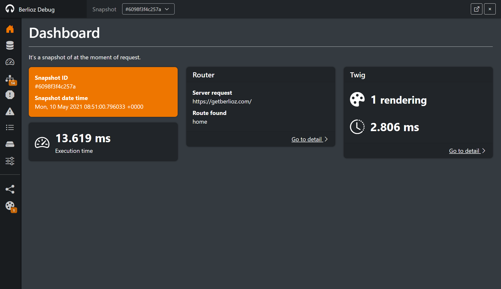

---
breadcrumb:
  - Getting started
  - Debug
---

# Debug

Berlioz provides a debug toolbar and console to facilitate your development.

## Toolbar

The toolbar is shown at the bottom left of your page, and indicates the execution time of the page.


> ℹ️ **Note**: If an error occurs during script execution, the check icon turns into a cross icon ;)

Two icons appear on hover. The first one hides the toolbar, and the second one moves the toolbar to the right (this
action is saved in a cookie to restore the position).

### Response time

> 🆕 **Info**: *Since version 3.4*

The toolbar displays the **response time**: the time until the response has been sent to the client. Work done
[after the response](../http/terminate.md) is not included. The console displays both the response time and the
**total time** of the request (dashboard and performances), and the activities timeline marks the moment the response
has been sent.

### Snapshot in progress

> 🆕 **Info**: *Since version 3.4*

The snapshot is saved at the very end of the request, after the work done after the response. Meanwhile, the toolbar
shows a clock icon with the response time, and the console a "Snapshot in progress" page: both reload automatically
once the snapshot is saved.

If the snapshot is never saved before a delay, because the process has been interrupted (timeout, memory limit, killed
worker...), the console displays "Snapshot incomplete" and the toolbar a cross icon. This delay is configured with
`berlioz.debug.pending_ttl`, in seconds; by default, the PHP `max_execution_time`, or 300 seconds if unlimited:

```json
{
  "berlioz": {
    "debug": {
      "pending_ttl": 60
    }
  }
}
```

The pending TTL only controls when the console labels an unfinished snapshot as incomplete; it does not stop PHP
or cancel deferred jobs. Choose a TTL that covers your expected after-response work. A snapshot saved later still
becomes available normally.

The console answers with the HTTP status `202` while the snapshot is in progress, `410` when it is incomplete, and
`404` when the snapshot is unknown.

## Console

To open the console, click on the toolbar.



### HTTP response

> 🆕 **Info**: *Since version 3.3*

The **HTTP / Router** section also displays the response status code, reason phrase, HTTP protocol version
and headers, allowing you to inspect the response alongside the request and routing information.

## Enable/Disable debug mode

By default, debug mode is not enabled. You need to enable it in your configuration file.

```json
{
  "berlioz": {
    "debug": {
      "enable": true
    }
  }
}
```

## Restrict to an IP or host

For security, you can restrict debug mode to some IP addresses or hosts.
In your configuration file, declare the list of authorized IP addresses and hosts, like this:

```json
{
  "berlioz": {
    "debug": {
      "enable": true,
      "ip": [
        "127.0.0.1",
        "getberlioz.com"
      ]
    }
  }
}
```

In this example, debug mode is enabled only for the local IP `127.0.0.1` and the host `getberlioz.com`.

### Client IP resolution behind a proxy

> 🆕 **Info**: *Since version 3.2*
>
> The client IP checked against the allow-list is now taken from `REMOTE_ADDR` and the `X-Forwarded-For` header is
> **no longer trusted by default**. Previously, a spoofed `X-Forwarded-For` header could bypass the IP restriction and
> enable the debug mode from any origin.

If your application runs behind a trusted reverse proxy or load balancer, declare the proxy addresses (single IPs or
CIDR ranges) under `berlioz.proxies.trusted`. Only then is the forwarded client IP taken into account:

```json
{
  "berlioz": {
    "proxies": {
      "trusted": [
        "10.0.0.0/8",
        "192.168.1.10"
      ]
    },
    "debug": {
      "enable": true,
      "ip": [
        "127.0.0.1",
        "getberlioz.com"
      ]
    }
  }
}
```

When no trusted proxy is configured, the forwarded headers are ignored and `REMOTE_ADDR` is used as the client IP.

## Snapshot retention

> 🆕 **Info**: *Since version 3.2*

When debug mode is enabled, Berlioz records a snapshot (debug report) for each request. To prevent the debug directory
from growing indefinitely, old snapshots are garbage collected **probabilistically on write**, according to a
retention policy configured under `berlioz.debug.gc`:

```json
{
  "berlioz": {
    "debug": {
      "enable": true,
      "gc": {
        "probability": 1,
        "divisor": 100,
        "max_age": 7,
        "max_files": 100
      }
    }
  }
}
```

- **`probability`** / **`divisor`**: the garbage collector runs with a probability of `probability / divisor` on each
  snapshot write (default `1 / 100`, i.e. ~1% of requests). Set `probability` to `0` to disable automatic collection.
- **`max_age`**: delete snapshots older than this number of days (`null` to disable).
- **`max_files`**: keep at most this number of snapshots, deleting the oldest ones beyond the limit (`null` to
  disable).

You can also trigger the cleanup manually with the [`berlioz:debug-clear`](../cli.md#berliozdebug-clear) CLI command.
