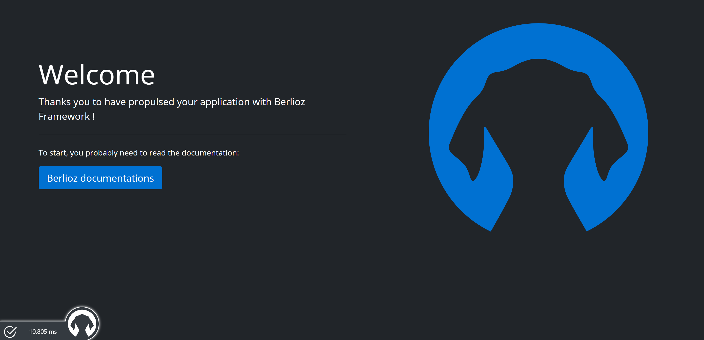
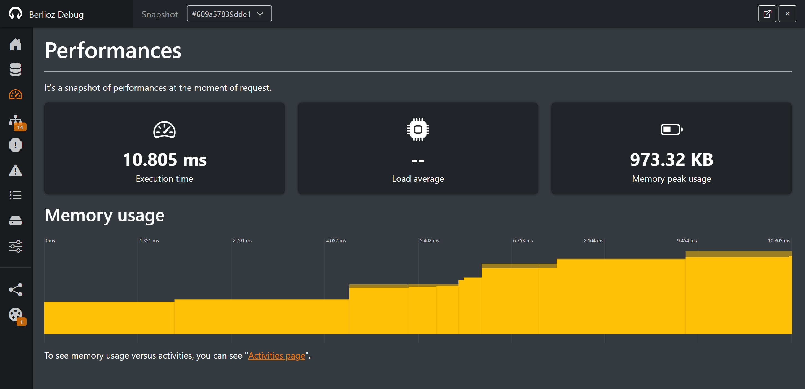

---
breadcrumb:
  - Getting started
  - Installation
keywords:
  - installation
summary-order: 1
---

# Installation

This page describes the default installation for most HTTP projects.
If you want to use **Berlioz Framework** for CLI projects, see [CLI Project](../cli.md) to learn more.

## Berlioz Framework

Berlioz Framework must be installed with [Composer](https://getcomposer.org/); it's the recommended
installation.

```bash
composer create-project berlioz/website-skeleton my-project --remove-vcs
```

You can specify the version to Composer:

```bash
composer create-project berlioz/website-skeleton my-project "3.0" --remove-vcs
```

> ℹ️ **Note**: The `--remove-vcs` option automatically removes the `.git` directory from the default project.

## HTTP server

To run the application, your HTTP server must point to the `public` directory.

### Apache server

[Apache](https://httpd.apache.org/) is the most popular web server.

For **Apache** version >= 2.4:

```apache
<VirtualHost *:80>
    ServerName getberlioz.com
    DocumentRoot "/path/to/my-project/public"

    <Directory "/path/to/my-project/public">
        AllowOverride All
        Require all granted
    </Directory>
</VirtualHost>
```

For **Apache** version < 2.4:

```apache
<VirtualHost *:80>
    ServerName getberlioz.com
    DocumentRoot "/path/to/my-project/public"

    <Directory "/path/to/my-project/public">
        AllowOverride All
        Allow from all
    </Directory>
</VirtualHost>
```

> ⚠️ **Warning**:
>
> You need to enable the **mod_rewrite** module on Apache.
>
> See the [Apache documentation](https://httpd.apache.org/docs/current/fr/mod/mod_rewrite.html) for installation.

If you want to increase the performance of your server, disable the support of `.htaccess` files.

To do that, you must specify the fallback resource to Apache and disable the `AllowOverride` option:

```apache
<Directory "/path/to/my-project/public">
    AllowOverride None
    FallbackResource /index.php
    # ...
</Directory>
```  

### Nginx

[Nginx](https://www.nginx.com) is a high-performance web server.

To run a PHP application with [Nginx](https://www.nginx.com), you need to
use [PHP FPM](http://php.net/manual/book.fpm.php) (FastCGI Process Manager).

```nginx
server {
    server_name getberlioz.com;
    root /path/to/my-project/public;

    # Test existent of file before redirect to fallback file: index.php
    location / {
        try_files $uri /index.php$is_args$args;
    }

    # Configuration for index.php file calls
    location ~ ^/index\.php(/|$) {
        # FastCGI configuration
        fastcgi_pass unix:/var/run/php/php-fpm.sock;
        fastcgi_split_path_info ^(.+\.php)(/.*)$;
        include fastcgi_params;

        # FastCGI parameters to give directory and script infos
        fastcgi_param SCRIPT_FILENAME $realpath_root$fastcgi_script_name;
        fastcgi_param DOCUMENT_ROOT $realpath_root;

        # To do not use index.php file for routes
        internal;
    }

    # To deny all others PHP files
    location ~ \.php$ {
        return 404;
    }
}
```

### PHP HTTP server

If you want to test the application without installing a web server, you can
use the [built-in web server](http://php.net/manual/features.commandline.webserver.php).

To start the server:

```bash
cd /path/of/project
cd public
php -S localhost:8000 index.php
```

In your web browser, go to the URL `http://localhost:8000`: you will see your project!

> ⚠️ **Warning**: The PHP built-in web server is only for a **development environment**.
> Do not use it in production!

## Test the first page

Open your favorite browser and go to your page, in our example: `getberlioz.com`.

If everything is OK, you will see this screen:



On this first page, you can also see the debug console of **Berlioz**. If you click on it, you will see the debug
details:


